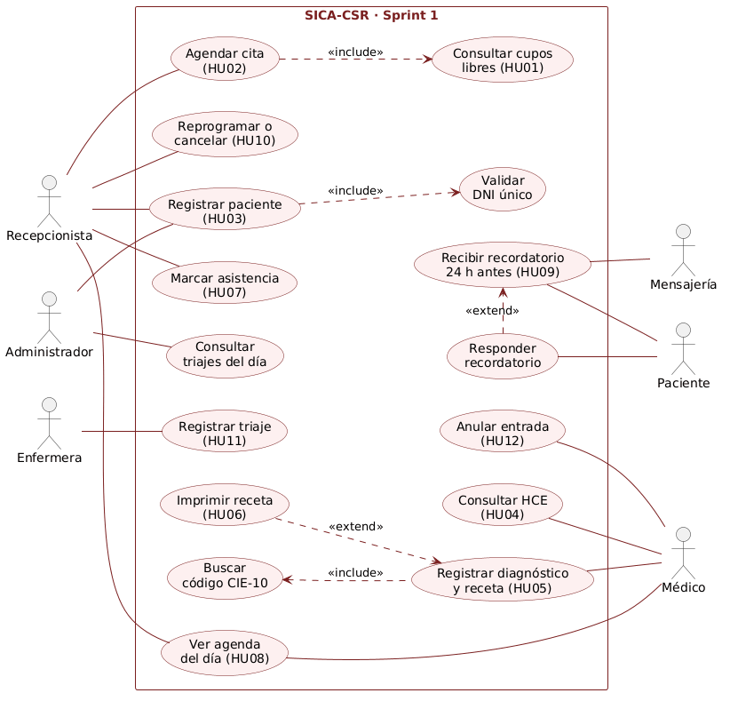
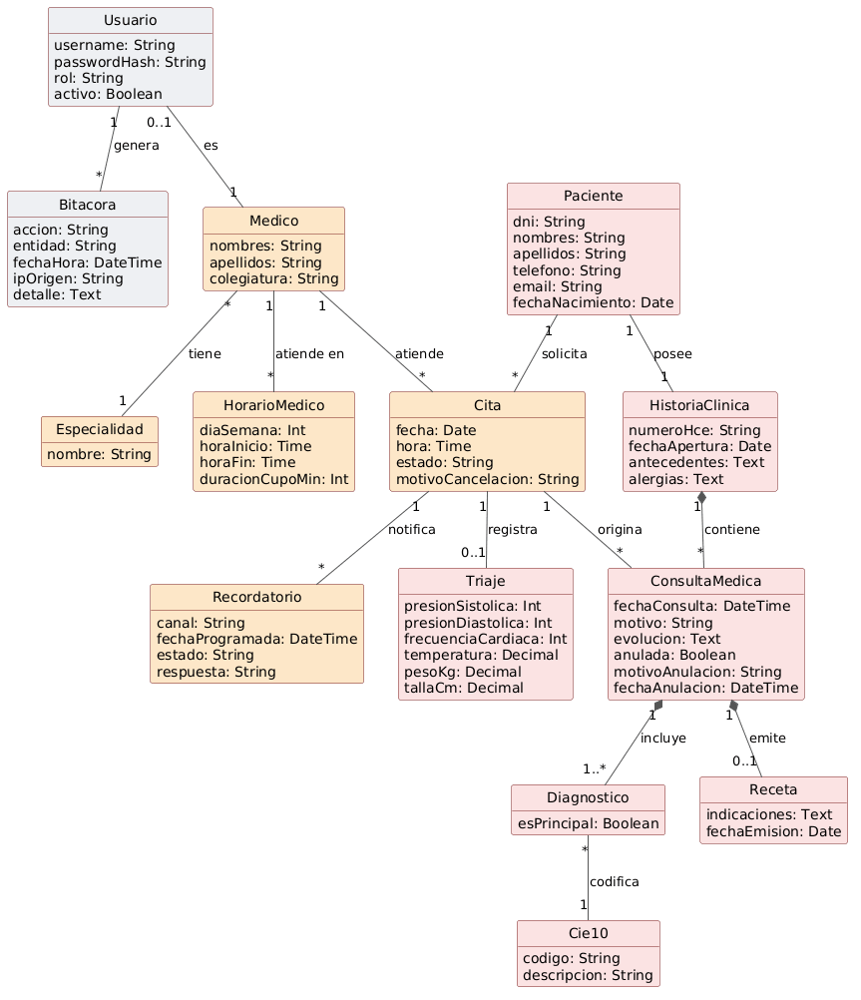
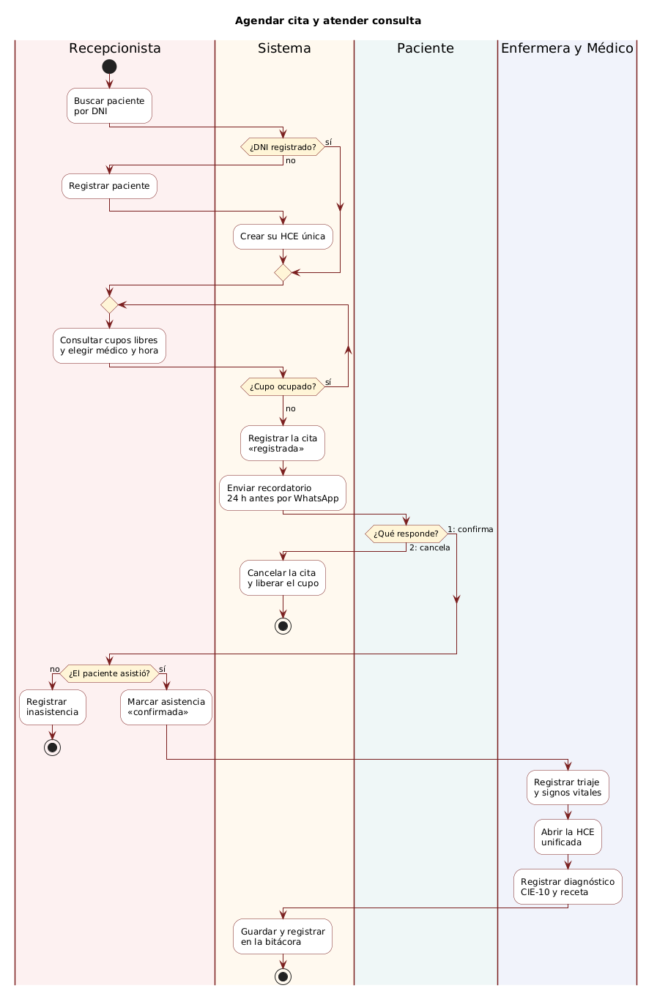

# 4. Modelos UML

## 4.1. Diagrama de casos de uso
* **Actores:** Recepcionista, Enfermera, Médico, Administrador, Paciente y Mensajería (sistema externo).
* **Descripción:** 
  * Recepcionista: registra pacientes, agenda, reprograma o cancela citas, marca la asistencia y consulta la agenda del día de cada médico.
  * Enfermera: registra el triaje.
  * Médico: ve su agenda del día, consulta la HCE unificada, registra el diagnóstico CIE-10 y la receta, y anula entradas con motivo.
  * Administrador: registra y actualiza la filiación de pacientes y consulta el triaje del día en solo lectura; no accede a la HCE. En el Sprint 2 consulta los indicadores del Dashboard Gerencial (M5).
  * Paciente: recibe el recordatorio 24 h antes y puede responderlo («1» confirma, «2» cancela).
  * Mensajería (sistema externo): envía el recordatorio por WhatsApp.
* **Relaciones:** 
  * `<<include>>`: Registrar un paciente siempre valida DNI único; agendar una cita siempre consulta cupos libres; registrar diagnóstico siempre busca el código CIE-10.
  * `<<extend>>`: Imprimir la receta ocurre solo a veces, después de registrarla; responder el recordatorio ocurre solo si el paciente contesta.
  * El inicio de sesión (JWT) y la bitácora son servicios transversales.

## 4.2. Diagrama de clases

* **Entidades centrales:** `Usuario`, `Bitacora`, `Paciente`, `HistoriaClinica`, `Medico`, `Especialidad`, `HorarioMedico`, `Cita`, `ConsultaMedica`, `Triaje`, `Cie10`, `Diagnostico`, `Receta`, `Recordatorio`.
* **Descripción:** Un paciente tiene una sola HCE (1..1) y la HCE contiene muchas consultas (composición); una cita puede tener un triaje (0..1) y originar consultas (solo una vigente, las anuladas se conservan); cada consulta incluye uno o más diagnósticos codificados con CIE-10 y máximo una receta; cada médico atiende en uno o más horarios semanales (`HorarioMedico`), a partir de los cuales se calculan los cupos. `Usuario` y `Bitacora` respaldan RFN01 y RFN04.

## 4.3. Diagrama de actividades

* **Proceso principal:** Agendar cita y atender consulta.
* **Carriles:** Recepcionista, Sistema, Paciente y Enfermera y Médico.
* **Decisiones clave:** ¿El DNI ya está registrado? (si no, registra paciente y crea su HCE); ¿el cupo está ocupado? (si sí, elige otro horario; la BD rechaza duplicados); ¿qué responde el paciente al recordatorio de WhatsApp? (con «2» la cita se cancela y el cupo se libera); ¿el paciente asistió? (si no, registra inasistencia).
