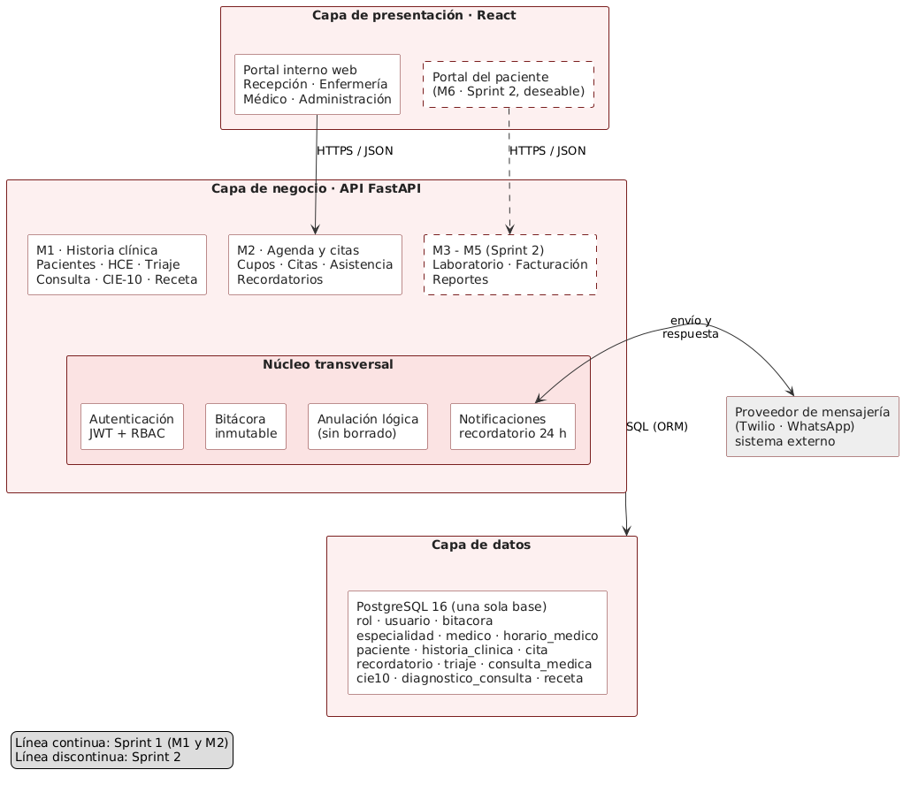
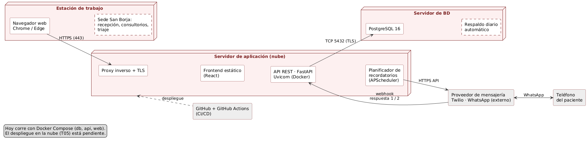

# 5. Documento de arquitectura de software (SAD)

## 5.1. Estilo arquitectónico

* **Estilo elegido:** Arquitectura en capas (presentación, negocio y datos) con una API REST monolítica modular, consumida por una SPA en React.
* **Justificación:** Prioriza simplicidad de construcción, prueba y despliegue para cumplir el timebox de la semana 11. Una sola base PostgreSQL garantiza transacciones ACID para la HCE y facilita apertura en <2s con 8 000 pacientes.

## 5.2. Vistas 4+1 (simplificadas)
* **Lógica:** Tres capas (SPA React en presentación, API FastAPI en negocio con módulos M1 y M2 y un núcleo transversal de autenticación JWT + RBAC, bitácora inmutable, anulación lógica y notificaciones, y PostgreSQL en datos). El portal del paciente y M3–M5 se agregan en el Sprint 2.
* **Procesos:** Flujos seguros mediante tokens JWT, validación de roles, verificación de cupos con transacciones atómicas e índices únicos parciales, tareas programadas para recordatorios (y un webhook que recibe la respuesta del paciente) y bitácora inmutable.
* **Desarrollo:** Repositorio en GitHub con carpetas `backend`, `frontend`, `db` y `pruebas`. Módulos independientes comunicados por servicios/endpoints.
* **Física:** Navegadores de la sede San Borja conectados por HTTPS (443) a un servidor de aplicación en la nube con proxy inverso TLS, frontend estático, API FastAPI en Docker y planificador de recordatorios; PostgreSQL en un servidor de BD con respaldo diario; Twilio envía los recordatorios por WhatsApp y devuelve la respuesta del paciente por webhook; despliegue con GitHub Actions. Hoy el sistema corre con Docker Compose y el despliegue en la nube (T05) está pendiente.

* **Escenarios:** Validación de DNI existente, rechazo de cupos ocupados (409), apertura de HCE unificada en <2s, y anulación lógica de entradas clínicas.

## 5.3. Decisiones de arquitectura (ADR)
* **ADR-01:** Arquitectura en capas con API REST monolítica modular y frontend SPA (React).
* **ADR-02:** PostgreSQL como única base de datos, con migraciones Alembic e índices por DNI y HCE.
* **ADR-03:** Autenticación JWT de corta duración con rol como claim, refresh token y middleware RBAC.
* **ADR-04:** Anulación lógica en vez de borrado físico mediante triggers en la base de datos.

## 5.4. Atributos de calidad
* **Rendimiento (RFN02):** Índices optimizados, validado con Locust (<2s percentil 95 con 8 000 pacientes).
* **Seguridad (RFN01):** JWT con RBAC, contraseñas con hash, HTTPS y bitácora inmutable.
* **Disponibilidad (RFN03):** Contenedor con health check, respaldo diario y objetivo de 99.5%.
* **Trazabilidad (RFN04):** Anulación lógica y triggers de bloqueo DELETE en tablas clínicas.
* **Usabilidad (RFN05):** SPA con pantallas simples (<3 clics para operaciones clave).

## 5.5. Stack tecnológico
* **Backend / API:** Python 3.12 + FastAPI (SQLAlchemy, Alembic).
* **Base de datos:** PostgreSQL 16.
* **Frontend:** React + Vite (SPA).
* **Seguridad:** JWT, RBAC, hash argon2/bcrypt, HTTPS/TLS.
* **Notificaciones:** Twilio WhatsApp en cuenta de prueba (*sandbox*) durante desarrollo y demostración. El modelo de datos admite también SMS y correo (`recordatorio.canal`) para habilitarlos más adelante sin cambiar la base. En producción el costo por mensaje de Twilio lo asume la clínica y se justifica por la reducción del *no-show* (18% → 8%).
* **Tareas programadas:** APScheduler dentro de la API para generar y enviar los recordatorios 24 h antes de la cita. La respuesta del paciente («1» confirma, «2» cancela) llega por un webhook de Twilio con firma verificada.
* **Hosting / Despliegue:** Docker en PaaS con capa gratuita o de costo acotado (p. ej., Render o Railway) y PostgreSQL gestionado.
* **CI / Pruebas:** GitHub Actions, pytest y Locust.
