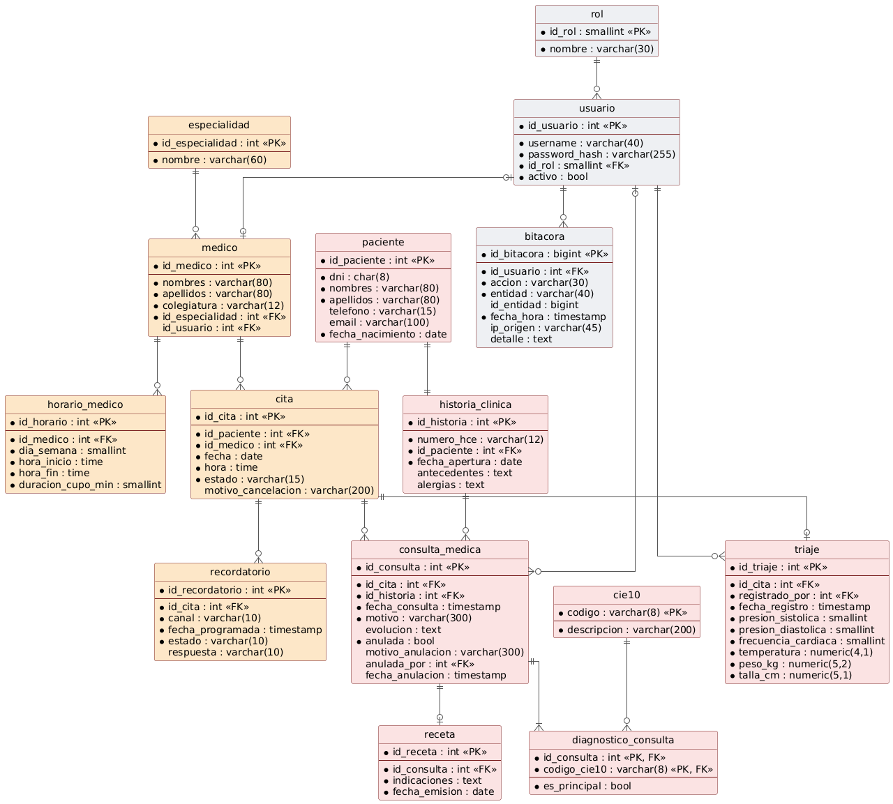

# 6. Modelo de base de datos

## 6.1. Modelo entidad-relación (ER)
El modelo del Sprint 1 relaciona las entidades de seguridad (roles, usuarios y bitácora de auditoría), pacientes, médicos, especialidades, horarios de atención, citas, historias clínicas, consultas médicas, triajes, diagnósticos CIE-10, recetas y recordatorios.



La tabla `horario_medico` guarda el rango de atención semanal de cada médico (relación `medico 1 — * horario_medico`); a partir de ella se calculan los cupos libres (RF07, RF09).

## 6.2. Diccionario de datos (tablas principales)
### Tabla: `paciente` (M1)
* `id_paciente` (PK): INTEGER, autogenerado.
* `dni`: CHAR(8), No nulo, único (evita duplicidad).
* `nombres`, `apellidos`: VARCHAR(80), No nulo.
* `telefono`, `email`: Contactos para recordatorios.
* `fecha_nacimiento`: DATE, No nulo.

### Tabla: `horario_medico` (M2)
* `id_horario` (PK): INTEGER, autogenerado.
* `id_medico` (FK): INTEGER.
* `dia_semana`: SMALLINT (1 = lunes … 7 = domingo).
* `hora_inicio`, `hora_fin`: TIME, rango de atención del médico.
* `duracion_cupo_min`: SMALLINT, duración de cada cupo (por defecto 20 min).

### Tabla: `cita` (M2)
* `id_cita` (PK): INTEGER, autogenerado.
* `id_paciente`, `id_medico` (FK): INTEGER.
* `fecha`, `hora`: DATE y TIME.
* `estado`: VARCHAR(15) (registrada, confirmada, triada, atendida, cancelada, inasistente).
* `motivo_cancelacion`: VARCHAR(200), obligatorio si está cancelada.

### Tabla: `triaje` (M1)
* `id_triaje` (PK): INTEGER, autogenerado.
* `id_cita` (FK, único): una cita tiene como máximo un triaje.
* `registrado_por` (FK a `usuario`): enfermera que registra.
* `presion_sistolica`, `presion_diastolica`, `frecuencia_cardiaca`: SMALLINT.
* `temperatura`, `peso_kg`, `talla_cm`: NUMERIC.

### Tabla: `consulta_medica` (M1)
* `id_consulta` (PK): INTEGER.
* `id_cita`, `id_historia` (FK): INTEGER.
* `fecha_consulta`, `motivo`, `evolucion`.
* `anulada` (BOOLEAN), `motivo_anulacion`, `anulada_por`, `fecha_anulacion`: obligatorios cuando `anulada` es verdadero.

### Tabla: `bitacora` (transversal)
* `id_bitacora` (PK): BIGINT.
* `id_usuario` (FK), `accion`, `entidad`, `id_entidad`, `fecha_hora`, `ip_origen`, `detalle`.
* Inmutable: no admite UPDATE ni DELETE.

## 6.3. Script DDL (Sprint 1)
```sql
-- ===== Seguridad y auditoría (RFN01) =====
CREATE TABLE rol (
    id_rol SMALLINT GENERATED ALWAYS AS IDENTITY PRIMARY KEY,
    nombre VARCHAR(30) NOT NULL UNIQUE -- recepcionista, enfermera, medico, administrador
);

CREATE TABLE usuario (
    id_usuario INTEGER GENERATED ALWAYS AS IDENTITY PRIMARY KEY,
    username VARCHAR(40) NOT NULL UNIQUE,
    password_hash VARCHAR(255) NOT NULL,
    id_rol SMALLINT NOT NULL REFERENCES rol(id_rol),
    activo BOOLEAN NOT NULL DEFAULT TRUE
);

CREATE TABLE bitacora (
    id_bitacora BIGINT GENERATED ALWAYS AS IDENTITY PRIMARY KEY,
    id_usuario INTEGER NOT NULL REFERENCES usuario(id_usuario),
    accion VARCHAR(30) NOT NULL,
    entidad VARCHAR(40) NOT NULL,
    id_entidad BIGINT,
    fecha_hora TIMESTAMP NOT NULL DEFAULT now(),
    ip_origen VARCHAR(45),
    detalle TEXT
);

-- ===== Médicos y agenda (M2) =====
CREATE TABLE especialidad (
    id_especialidad INTEGER GENERATED ALWAYS AS IDENTITY PRIMARY KEY,
    nombre VARCHAR(60) NOT NULL UNIQUE
);

CREATE TABLE medico (
    id_medico INTEGER GENERATED ALWAYS AS IDENTITY PRIMARY KEY,
    nombres VARCHAR(80) NOT NULL,
    apellidos VARCHAR(80) NOT NULL,
    colegiatura VARCHAR(12) NOT NULL UNIQUE,
    id_especialidad INTEGER NOT NULL REFERENCES especialidad(id_especialidad),
    id_usuario INTEGER UNIQUE REFERENCES usuario(id_usuario)
);

CREATE TABLE horario_medico (
    id_horario INTEGER GENERATED ALWAYS AS IDENTITY PRIMARY KEY,
    id_medico INTEGER NOT NULL REFERENCES medico(id_medico),
    dia_semana SMALLINT NOT NULL CHECK (dia_semana BETWEEN 1 AND 7),
    hora_inicio TIME NOT NULL,
    hora_fin TIME NOT NULL,
    duracion_cupo_min SMALLINT NOT NULL DEFAULT 20 CHECK (duracion_cupo_min > 0),
    CONSTRAINT ck_horario_rango CHECK (hora_fin > hora_inicio)
);

-- ===== Pacientes y HCE (M1) =====
CREATE TABLE paciente (
    id_paciente INTEGER GENERATED ALWAYS AS IDENTITY PRIMARY KEY,
    dni CHAR(8) NOT NULL UNIQUE CHECK (dni ~ '^[0-9]{8}$'),
    nombres VARCHAR(80) NOT NULL,
    apellidos VARCHAR(80) NOT NULL,
    telefono VARCHAR(15),
    email VARCHAR(100),
    fecha_nacimiento DATE NOT NULL CHECK (fecha_nacimiento <= CURRENT_DATE)
);

CREATE SEQUENCE seq_numero_hce START 1;

CREATE TABLE historia_clinica (
    id_historia INTEGER GENERATED ALWAYS AS IDENTITY PRIMARY KEY,
    numero_hce VARCHAR(12) NOT NULL UNIQUE DEFAULT ('HCE-' || LPAD(nextval('seq_numero_hce')::TEXT, 6, '0')),
    id_paciente INTEGER NOT NULL UNIQUE REFERENCES paciente(id_paciente),
    fecha_apertura DATE NOT NULL DEFAULT CURRENT_DATE,
    antecedentes TEXT,
    alergias TEXT
);

-- ===== Citas (M2) =====
CREATE TABLE cita (
    id_cita INTEGER GENERATED ALWAYS AS IDENTITY PRIMARY KEY,
    id_paciente INTEGER NOT NULL REFERENCES paciente(id_paciente),
    id_medico INTEGER NOT NULL REFERENCES medico(id_medico),
    fecha DATE NOT NULL,
    hora TIME NOT NULL,
    estado VARCHAR(15) NOT NULL DEFAULT 'registrada' CHECK (estado IN ('registrada','confirmada','triada','atendida','cancelada','inasistente')),
    motivo_cancelacion VARCHAR(200),
    CONSTRAINT ck_cita_motivo CHECK (estado <> 'cancelada' OR motivo_cancelacion IS NOT NULL)
);

-- Un cupo (médico, fecha, hora) solo puede tener una cita vigente (RF08 → HTTP 409)
CREATE UNIQUE INDEX ux_cita_cupo ON cita (id_medico, fecha, hora) WHERE estado <> 'cancelada';
CREATE INDEX ix_cita_paciente ON cita (id_paciente);

CREATE TABLE recordatorio (
    id_recordatorio INTEGER GENERATED ALWAYS AS IDENTITY PRIMARY KEY,
    id_cita INTEGER NOT NULL REFERENCES cita(id_cita),
    canal VARCHAR(10) NOT NULL CHECK (canal IN ('sms','whatsapp','email')),
    fecha_programada TIMESTAMP NOT NULL,
    estado VARCHAR(10) NOT NULL DEFAULT 'pendiente' CHECK (estado IN ('pendiente','enviado','fallido')),
    respuesta VARCHAR(10) CHECK (respuesta IN ('confirma','cancela'))
);

CREATE INDEX ix_recordatorio_pendiente ON recordatorio (fecha_programada) WHERE estado = 'pendiente';

-- ===== Atención clínica (M1) =====
CREATE TABLE triaje (
    id_triaje INTEGER GENERATED ALWAYS AS IDENTITY PRIMARY KEY,
    id_cita INTEGER NOT NULL UNIQUE REFERENCES cita(id_cita),
    registrado_por INTEGER NOT NULL REFERENCES usuario(id_usuario),
    fecha_registro TIMESTAMP NOT NULL DEFAULT now(),
    presion_sistolica SMALLINT NOT NULL CHECK (presion_sistolica BETWEEN 50 AND 300),
    presion_diastolica SMALLINT NOT NULL CHECK (presion_diastolica BETWEEN 30 AND 200),
    frecuencia_cardiaca SMALLINT NOT NULL CHECK (frecuencia_cardiaca BETWEEN 20 AND 250),
    temperatura NUMERIC(4,1) NOT NULL CHECK (temperatura BETWEEN 30 AND 45),
    peso_kg NUMERIC(5,2) NOT NULL CHECK (peso_kg > 0),
    talla_cm NUMERIC(5,1) NOT NULL CHECK (talla_cm > 0)
);

CREATE TABLE consulta_medica (
    id_consulta INTEGER GENERATED ALWAYS AS IDENTITY PRIMARY KEY,
    id_cita INTEGER NOT NULL REFERENCES cita(id_cita),
    id_historia INTEGER NOT NULL REFERENCES historia_clinica(id_historia),
    fecha_consulta TIMESTAMP NOT NULL DEFAULT now(),
    motivo VARCHAR(300) NOT NULL,
    evolucion TEXT,
    anulada BOOLEAN NOT NULL DEFAULT FALSE,
    motivo_anulacion VARCHAR(300),
    anulada_por INTEGER REFERENCES usuario(id_usuario),
    fecha_anulacion TIMESTAMP,
    CONSTRAINT ck_consulta_anulacion CHECK (
        NOT anulada OR (motivo_anulacion IS NOT NULL AND anulada_por IS NOT NULL AND fecha_anulacion IS NOT NULL)
    )
);

-- Una cita origina como máximo una consulta vigente; las anuladas se conservan
CREATE UNIQUE INDEX ux_consulta_vigente ON consulta_medica (id_cita) WHERE NOT anulada;
-- Apertura de la HCE en <2 s (RFN02)
CREATE INDEX ix_consulta_historia ON consulta_medica (id_historia, fecha_consulta DESC);

CREATE TABLE cie10 (
    codigo VARCHAR(8) PRIMARY KEY,
    descripcion VARCHAR(200) NOT NULL
);

CREATE TABLE diagnostico_consulta (
    id_consulta INTEGER NOT NULL REFERENCES consulta_medica(id_consulta),
    codigo_cie10 VARCHAR(8) NOT NULL REFERENCES cie10(codigo),
    es_principal BOOLEAN NOT NULL DEFAULT FALSE,
    PRIMARY KEY (id_consulta, codigo_cie10)
);

CREATE UNIQUE INDEX ux_diagnostico_principal ON diagnostico_consulta (id_consulta) WHERE es_principal;

CREATE TABLE receta (
    id_receta INTEGER GENERATED ALWAYS AS IDENTITY PRIMARY KEY,
    id_consulta INTEGER NOT NULL UNIQUE REFERENCES consulta_medica(id_consulta),
    indicaciones TEXT NOT NULL,
    fecha_emision DATE NOT NULL DEFAULT CURRENT_DATE
);

-- ===== Trazabilidad (RFN04): sin borrado físico =====
CREATE FUNCTION fn_bloquear_borrado() RETURNS trigger AS $$
BEGIN
    RAISE EXCEPTION 'Operacion % prohibida en %: los registros no se borran (use anulacion logica, RFN04)', TG_OP, TG_TABLE_NAME;
END;
$$ LANGUAGE plpgsql;

CREATE TRIGGER trg_no_delete_paciente BEFORE DELETE ON paciente
FOR EACH ROW EXECUTE FUNCTION fn_bloquear_borrado();
CREATE TRIGGER trg_no_delete_historia BEFORE DELETE ON historia_clinica
FOR EACH ROW EXECUTE FUNCTION fn_bloquear_borrado();
CREATE TRIGGER trg_no_delete_cita BEFORE DELETE ON cita
FOR EACH ROW EXECUTE FUNCTION fn_bloquear_borrado();
CREATE TRIGGER trg_no_delete_triaje BEFORE DELETE ON triaje
FOR EACH ROW EXECUTE FUNCTION fn_bloquear_borrado();
CREATE TRIGGER trg_no_delete_consulta BEFORE DELETE ON consulta_medica
FOR EACH ROW EXECUTE FUNCTION fn_bloquear_borrado();
CREATE TRIGGER trg_no_delete_diagnostico BEFORE DELETE ON diagnostico_consulta
FOR EACH ROW EXECUTE FUNCTION fn_bloquear_borrado();
CREATE TRIGGER trg_no_delete_receta BEFORE DELETE ON receta
FOR EACH ROW EXECUTE FUNCTION fn_bloquear_borrado();

-- La bitácora es inmutable: ni UPDATE ni DELETE (RFN01)
CREATE TRIGGER trg_bitacora_inmutable BEFORE UPDATE OR DELETE ON bitacora
FOR EACH ROW EXECUTE FUNCTION fn_bloquear_borrado();

-- ===== Datos de referencia =====
INSERT INTO rol (nombre) VALUES ('administrador'), ('recepcionista'), ('enfermera'), ('medico');
```
