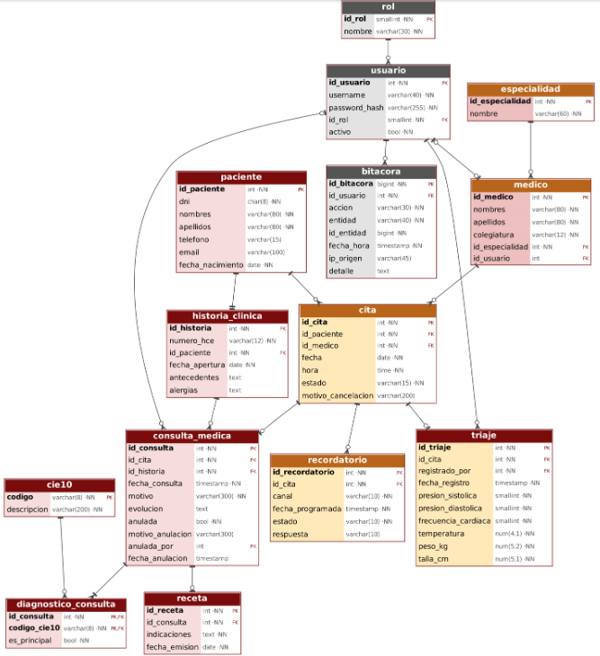

# 6. Modelo de base de datos

## 6.1. Modelo entidad-relación (ER)
El modelo relaciona las entidades principales de pacientes, médicos, especialidades, citas, historias clínicas, consultas médicas, triajes, diagnósticos CIE-10, recetas y bitácora de auditoría.



## 6.2. Diccionario de datos (tablas principales)
### Tabla: `paciente` (M1)
* `id_paciente` (PK): INTEGER, autogenerado.
* `dni`: CHAR(8), No nulo, único (evita duplicidad).
* `nombres`, `apellidos`: VARCHAR(80), No nulo.
* `telefono`, `email`: Contactos para recordatorios.
* `fecha_nacimiento`: DATE, No nulo.

### Tabla: `cita` (M2)
* `id_cita` (PK): INTEGER, autogenerado.
* `id_paciente`, `id_medico` (FK): INTEGER.
* `fecha`, `hora`: DATE y TIME.
* `estado`: VARCHAR(15) (registrada, confirmada, triada, atendida, cancelada, inasistente).
* `motivo_cancelacion`: VARCHAR(200), obligatorio si está cancelada.

### Tabla: `consulta_medica` (M1)
* `id_consulta` (PK): INTEGER.
* `id_cita`, `id_historia` (FK): INTEGER.
* `fecha_consulta`, `motivo`, `evolucion`.
* `anulada` (BOOLEAN), `motivo_anulacion`, `anulada_por`, `fecha_anulacion`.

## 6.3. Script DDL (extracto)
```sql
CREATE TABLE paciente (
    id_paciente INTEGER GENERATED ALWAYS AS IDENTITY PRIMARY KEY,
    dni CHAR(8) NOT NULL UNIQUE CHECK (dni ~ '^[0-9]{8}$'),
    nombres VARCHAR(80) NOT NULL,
    apellidos VARCHAR(80) NOT NULL,
    telefono VARCHAR(15),
    email VARCHAR(100),
    fecha_nacimiento DATE NOT NULL CHECK (fecha_nacimiento <= CURRENT_DATE)
);

CREATE SEQUENCE seq_numero_hce START 1;

CREATE TABLE historia_clinica (
    id_historia INTEGER GENERATED ALWAYS AS IDENTITY PRIMARY KEY,
    numero_hce VARCHAR(12) NOT NULL UNIQUE DEFAULT ('HCE-' || LPAD(nextval('seq_numero_hce')::TEXT, 6, '0')),
    id_paciente INTEGER NOT NULL UNIQUE REFERENCES paciente(id_paciente),
    fecha_apertura DATE NOT NULL DEFAULT CURRENT_DATE,
    antecedentes TEXT,
    alergias TEXT
);

CREATE TABLE cita (
    id_cita INTEGER GENERATED ALWAYS AS IDENTITY PRIMARY KEY,
    id_paciente INTEGER NOT NULL REFERENCES paciente(id_paciente),
    id_medico INTEGER NOT NULL REFERENCES medico(id_medico),
    fecha DATE NOT NULL,
    hora TIME NOT NULL,
    estado VARCHAR(15) NOT NULL DEFAULT 'registrada' CHECK (estado IN ('registrada','confirmada','triada','atendida','cancelada','inasistente')),
    motivo_cancelacion VARCHAR(200),
    CONSTRAINT ck_cita_motivo CHECK (estado <> 'cancelada' OR motivo_cancelacion IS NOT NULL)
);

CREATE UNIQUE INDEX ux_cita_cupo ON cita (id_medico, fecha, hora) WHERE estado <> 'cancelada';

CREATE FUNCTION fn_bloquear_borrado() RETURNS trigger AS $$
BEGIN
    RAISE EXCEPTION 'Operacion % prohibida en %: los registros no se borran (use anulacion logica, RFN04)', TG_OP, TG_TABLE_NAME;
END;
$$ LANGUAGE plpgsql;

CREATE TRIGGER trg_no_delete_paciente BEFORE DELETE ON paciente
FOR EACH ROW EXECUTE FUNCTION fn_bloquear_borrado();
```
