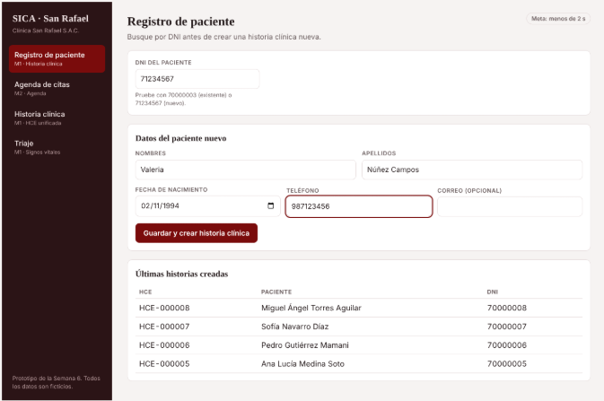
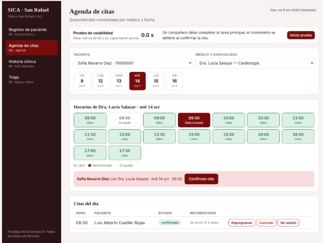
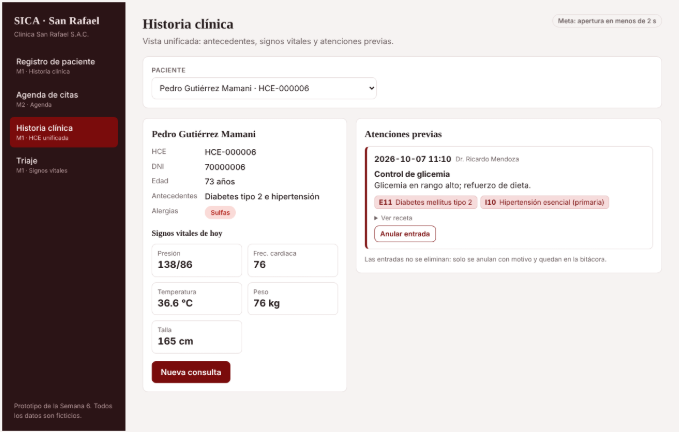
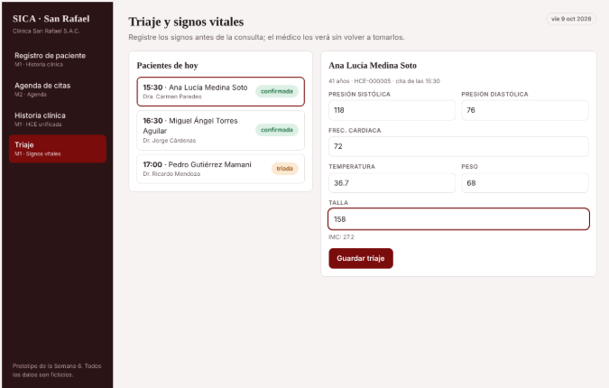

# 7. Prototipo UX/UI

## 7.1. Pantalla — Registro de paciente (M1 • HU03)
* **Descripción:** Pantalla de recepción para registrar pacientes con DNI de 8 dígitos. Si el DNI existe, el sistema avisa y abre la HCE existente; si es nuevo, registra y asigna el número de HCE.

## 7.2. Pantalla — Agenda de citas (M2 • HU01, HU02, HU10)
* **Descripción:** Grilla de horarios por médico y fecha con cupos libres y ocupados. Impide duplicar reservas y permite cancelar liberando el cupo de inmediato.

## 7.3. Pantalla — Historia clínica unificada (M1 • HU04, HU05)
* **Descripción:** Vista consolidada de antecedentes, alergias y consultas previas con diagnósticos CIE-10 y recetas. Permite registrar nuevas consultas y anular entradas con motivo.

## 7.4. Pantalla — Triaje y Signos vitales (M2 • HU11)
* **Descripción:** Permite a la enfermera registrar presión arterial, frecuencia cardíaca, temperatura, peso y talla, actualizando el estado de la cita a <<Triado>>.

## 7.5. Flujo de navegación
1. **Ingreso:** El usuario inicia sesión y ve el menú según su rol.
2. **Registro:** Recepción ingresa DNI para consultar o crear HCE.
3. **Agenda:** Recepción reserva, reprograma o cancela cupos y gestiona recordatorios.
4. **Atención:** Enfermería registra triaje y médico abre HCE para atender con CIE-10 y receta.
