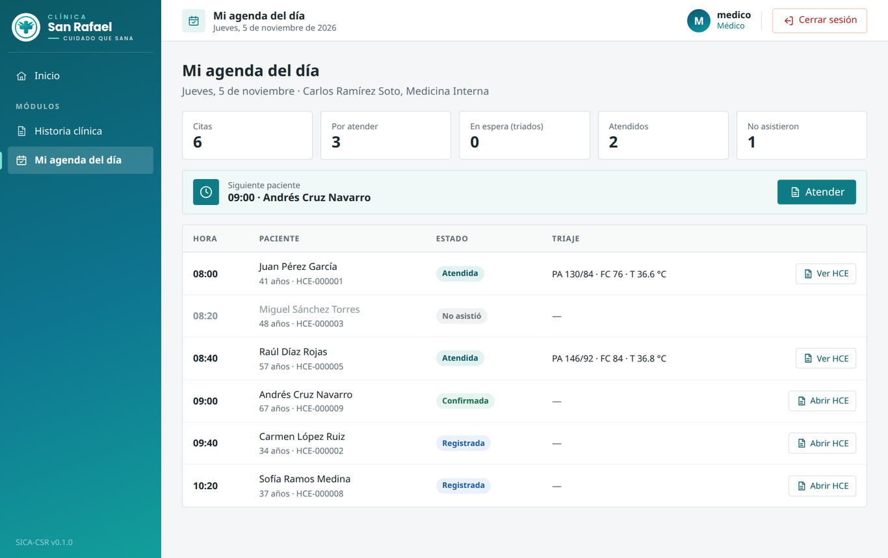

# 7. Prototipo UX/UI

Las pantallas corresponden al prototipo navegable del sistema, con datos ficticios; el menú lateral cambia según el rol que inicia sesión.

## 7.1. Pantalla — Registro de paciente (M1 • HU03)
* **Descripción:** Pantalla de recepción para buscar y registrar pacientes. Primero se verifica el DNI de 8 dígitos: si ya existe, el sistema muestra el paciente y su HCE; si es nuevo, se completan los datos y se asigna el número de HCE.

## 7.2. Pantalla — Agenda de citas (M2 • HU01, HU02, HU07, HU09, HU10)
* **Descripción:** Grilla de cupos por médico y fecha (calculados desde su horario de atención) con cupos libres y ocupados. Impide duplicar reservas, muestra el estado del recordatorio y permite marcar asistencia, reprogramar o cancelar liberando el cupo de inmediato.

## 7.3. Pantalla — Historia clínica unificada (M1 • HU04, HU05, HU06, HU12)
* **Descripción:** Vista consolidada de antecedentes, alergias y consultas previas con diagnósticos CIE-10 y recetas. Permite registrar nuevas consultas y anular entradas con motivo.

## 7.4. Pantalla — Triaje y Signos vitales (M1 • HU11)
* **Descripción:** Permite a la enfermera registrar presión arterial, frecuencia cardíaca, temperatura, peso y talla, actualizando el estado de la cita a «triada».

## 7.5. Pantalla — Agenda del médico (M2 • HU08)
* **Descripción:** El médico ve solo sus citas del día ordenadas por hora, con su estado y el triaje, y abre la HCE del siguiente paciente. Recepción ve la agenda de cualquier médico en solo lectura.

## 7.6. Flujo de navegación
1. **Ingreso:** El usuario inicia sesión y ve el menú según su rol.
2. **Registro:** Recepción ingresa DNI para consultar o crear HCE.
3. **Agenda:** Recepción reserva, reprograma o cancela cupos y marca la asistencia; el sistema envía el recordatorio 24 h antes de forma automática.
4. **Atención:** Enfermería registra el triaje; el médico revisa su agenda del día y abre la HCE para atender con CIE-10 y receta.
